

  <picture>
    <source media="(prefers-color-scheme: dark)" srcset="assets/hero-dark.png">
    <source media="(prefers-color-scheme: light)" srcset="assets/hero-light.png">
    
  </picture>

  
  
  
  
  

  <a href="#download--install"><strong>Download</strong></a> ·
  <a href="#watch-it-work">Demo</a> ·
  <a href="#screenshots">Screenshots</a> ·
  <a href="#programmer">Programmer+</a> ·
  <a href="#network">Network+</a> ·
  <a href="#bas-copilot">BAS Copilot</a> ·
  <a href="#system-requirements">Requirements</a> ·
  <a href="#faq">FAQ</a> ·
  <a href="#license">License</a>

---

**BAS Hub** is a desktop suite for building-automation controls work. Instead of a pocketful of separate tools — one for programming, one for discovery, one for captures, one for the terminal, a spreadsheet for the records — BAS Hub is one app whose modules share **one device inventory, one backup system, and one standard of care**. A device you find in Network+ is the same record everywhere. A write to a live controller goes through the same safety path every time. Your data lives on your laptop, in one folder, and nothing leaves it unless you send it.

> **Current release: 0.9.0** — the first release of the suite (0.9.1 is in preparation). This repository carries the release downloads and this page. It contains no source code, and it never will: BAS Hub is proprietary software.

## Contents

- [Watch it work](#watch-it-work)
- [Who it's for](#who-its-for)
- [One hub, not a folder of tools](#one-hub-not-a-folder-of-tools)
- [The modules](#the-modules)
- [Home — one launcher, one inventory](#home--one-launcher-one-inventory)
- [Programmer+ — the PPCL workbench](#programmer)
- [Network+ — the network workbench](#network)
- [BAS Copilot — help that stays on the machine](#bas-copilot)
- [Screenshots](#screenshots)
- [Download & install](#download--install)
- [System requirements](#system-requirements)
- [Updates](#updates)
- [Your data, maintenance, and uninstalling](#your-data-maintenance-and-uninstalling)
- [Trust, by design](#trust-by-design)
- [FAQ](#faq)
- [License](#license)

## Watch it work

  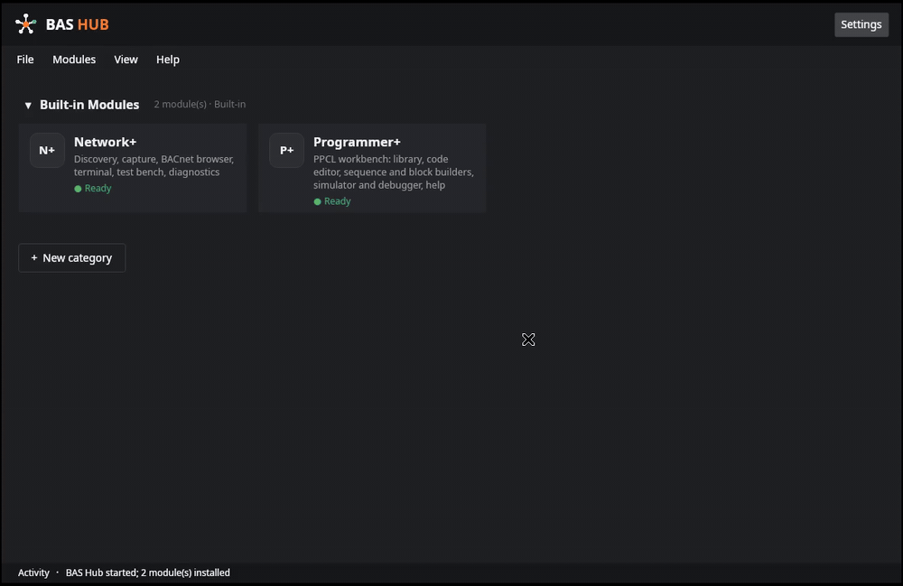

<em>The shipping build, live: home → Network+ → Health → Programmer+. No mockups — every screenshot on this page is the real app.</em>

## Who it's for

Controls technicians and engineers who commission, service, and troubleshoot building automation systems: BACnet networks that misbehave, PPCL programs that need writing or fixing, devices that need proving before you leave the site. BAS Hub is written in the language of the work — its screens start from the job you came to do, not from the protocol underneath it.

## One hub, not a folder of tools

| The job | The usual sprawl | In BAS Hub |
| --- | --- | --- |
| Keep track of devices | Every tool keeps its own list — or a spreadsheet does | **One inventory** every module shares; find a device once, use it everywhere |
| Write and check a PPCL program | An editor here, a separate checker there, files passed by hand | Editor, checks, builder, simulator, and debugger in **one workbench** |
| Change something on a live controller | Command it and rely on your own ritual for safety | **Preview → backup → confirm → verify → rollback**, the same path every time |
| Read a packet capture | Raw hex and a protocol reference open beside it | **Plain sentences first**, full decode underneath |
| Know whether the network is healthy | Gut feel and spot checks | A **40-check catalog** whose score always shows its findings |
| Get a second pair of eyes | A cloud chatbot — and your site data on someone else's server | **BAS Copilot**: optional, on-device — or not installed at all |

## The modules

<table>
  <tr>
    <td width="25%" align="center">
       
      <strong>The Hub</strong> 
      The home screen and launcher. Your modules as tiles, your own categories of shortcuts to the tools you already use, one settings home.
    </td>
    <td width="25%" align="center">
       
      <strong>Programmer+</strong> 
      The PPCL workbench: editor, block builder, simulator and debugger, point database, and code library.
    </td>
    <td width="25%" align="center">
       
      <strong>Network+</strong> 
      The network workbench: find devices, look at them, watch traffic, check health, prove changes, talk, and keep records.
    </td>
    <td width="25%" align="center">
       
      <strong>BAS Copilot</strong> <em>(optional)</em> 
      An assistant that runs entirely on your computer. If you don't install it, there is no chat surface anywhere in BAS Hub.
    </td>
  </tr>
</table>

## Home — one launcher, one inventory

Installed modules sit pinned at the top with honest ready states. Below them, your own categories hold shortcuts to the external tools you already use — drag them into the order you work in. There is no "site mode" to be in and no site picker standing in front of your tools: all work is siteless, and **Sites** appear exactly where they belong — as a *Save to a site* option when you save or back something up, and in the records view when you want to browse what's filed. The things you file — captures, reports, backups, session logs — collect against the device and the site, so the next visit starts from evidence instead of memory.

  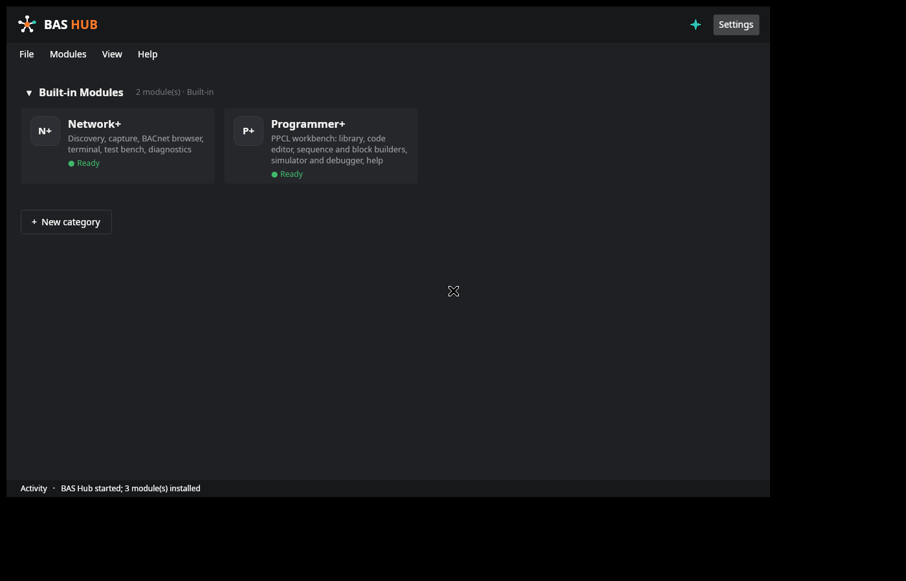

## Programmer+ — the PPCL workbench

A full workbench for PPCL (the Siemens panel programming language), rebuilt as a native module of the Hub. Programmer+ works on program files — it never communicates with a panel.

- **An editor that checks as you type.** Syntax colouring and a findings panel driven by **97 named diagnostics and logic checks**. Every finding says what to do, why it matters, and where the rule comes from — including cross-line logic checks that catch a start command cancelling itself within the same pass. Command Assist (Ctrl+Space) with reference cards for the full command set, hover cards, find/replace, automatic formatting, and renumbering that rewrites every reference.
- **A builder that compiles to PPCL.** Block diagrams (31 block types), sequences written as structured lines, and decision tables — all compiling to program text, with plain-language refusals when something can't compile instead of silent guesses. Convert between text and blocks in both directions; a conversion always lands as a new item, never over your original.
- **A simulator and debugger.** Run a program against a plant before you ever touch a panel: live trend charts, run comparison overlays, and a **time-scrub** back through every recorded pass. The debugger offers breakpoints — including watchpoints that stop when a point is *written* — stepping, run-to-cursor, and coverage. Plants can inject faults, and a free-run mode runs your logic against a bare point store whose inputs never move on their own, so the trace is evidence about the logic, and only the logic.
- **Library, point database, and imports.** A file-based code library with collections, tags, and provenance; the point database with unresolved-reference marks in the editor; start/stop optimisation; and vendor imports that arrive with a fidelity report stating, per item, what mapped cleanly, what was approximated, and what didn't map at all.
- **Help inside the module.** A searchable 21-topic help, including the block reference, lives in Programmer+ itself — offline, like everything else.

  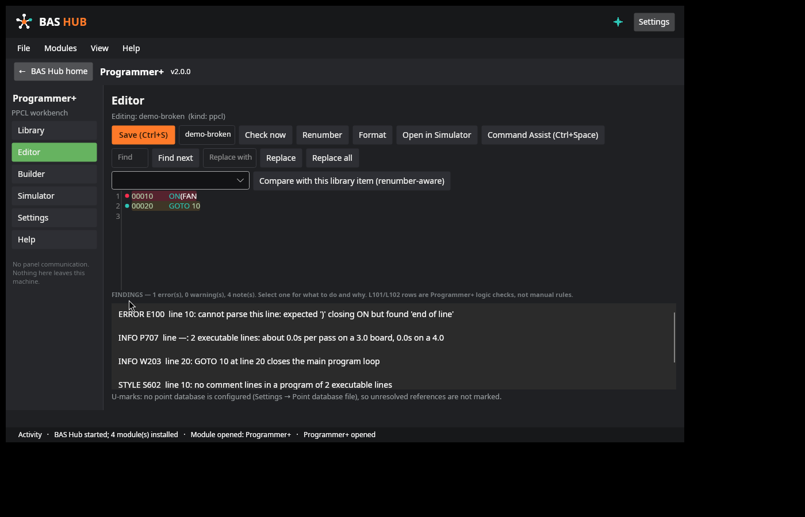

  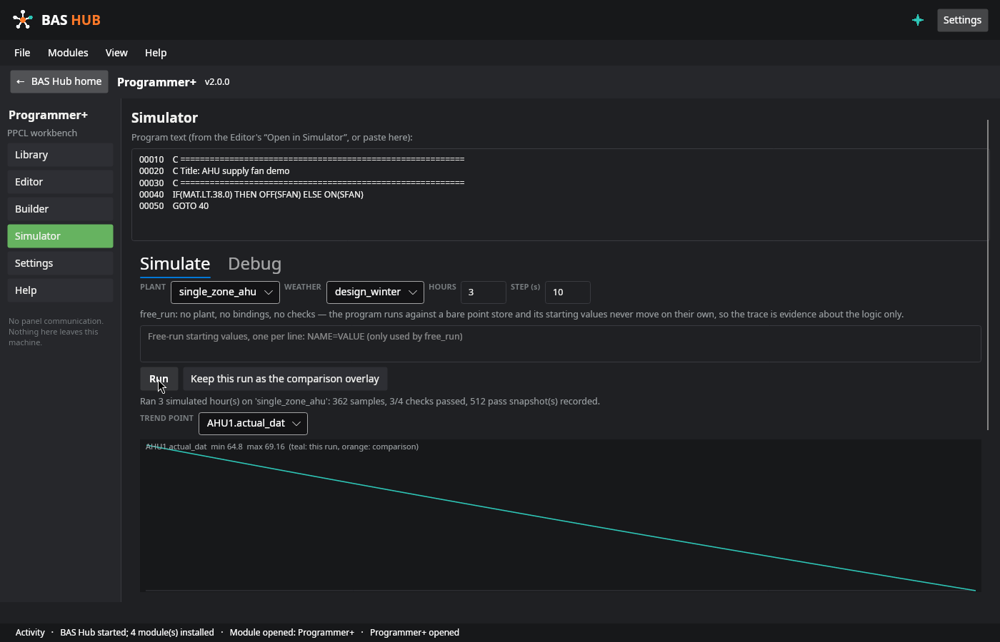

<strong>Programmer+ in full — the complete capability list</strong>

**Language & checking**
- Full PPCL language core: lexer, error-tolerant parser (a bad line is flagged, never fatal to the file), and control/data-flow analysis across the whole program, including loop wrap-around.
- 90 lint rules in five families — syntax, flow, semantics, style, performance — each with a fix guide; panel-report findings (R-codes) for the problems panels themselves report; and two cross-line logic checks of Programmer+'s own (labelled as such in the panel — they are not manual rules).
- Findings are a triad, always: what to do, why it matters, and the source the rule comes from.
- Formatter and transforms: DEFINE expand/collapse, separator swap, clone-range, enable/disable lines, comment tools — all reference-aware, so renumbering rewrites every GOTO, DEFINE, and point reference consistently.

**Authoring**
- Program generator with five templates, plus engineering helpers.
- Sequence documents: describe the sequence in structured lines (points, modes, a decision table); the compiler writes the PPCL; sequences round-trip exactly between their text form and the model.
- Block diagrams: 31 block types, an expression-first compiler, and cycle refusal in plain language.
- Plain-English sequence-of-operations import: paste the SOO text and each item lands with a citation to the line it came from — and an honest list of what couldn't be resolved.
- Vendor imports: block-diagram files and Desigo panel exports (.P2), each with a mapped / approximated / unmapped fidelity report. The .P2 importer is labelled inside the app for what it is: built and fixture-tested, **not yet validated against a real panel export** — the first thing it will tell you, in its own window.
- Redact-for-sharing: strip a program for sending with the point-name mapping kept on your machine only.

**Simulation & debugging**
- Compile-once simulation with exact priority arbitration — one implementation of statement semantics, so the editor, simulator, and debugger can never disagree about what a line does.
- Plant models from components up to composed systems; a bench with **22 fault kinds**, pass/fail checks, trends, run comparison, and saved JSON scenarios.
- Time-scrub: every pass of a run is snapshotted; scrub back and inspect any point at any pass instead of re-running to the moment that mattered.
- Debugger: line breakpoints, write-watchpoints, condition breakpoints, step in/over/out, run-to-cursor, a statement budget so a runaway loop stops instead of hanging, and coverage.
- Declared approximations, in the open: the PID LOOP output is approximated (the vendor doesn't publish the form) and a small family of panel functions trace as no-ops in simulation. The bench says so rather than faking fidelity.

**Library & data**
- File-based library: collections, auto-categories, tags, provenance and lint state recorded at save; archive export/import with collision policies.
- Point database: CSV/JSON import with column aliases; unrecognised columns are reported, never guessed; unresolved references get U-marks in the editor gutter.
- 21 settings, all real controls that drive the other panes — validated, never silently clamped.
- An append-only error log in plain language: you see a message and a reference code, never a stack trace.

## Network+ — the network workbench

Network+ opens on **jobs, in plain language** — find what's on this network, look at a device, why is this device offline, check this network's health, watch the traffic, prove this works, change something safely, talk to a device, what changed since last time. Pick the job, not the protocol.

  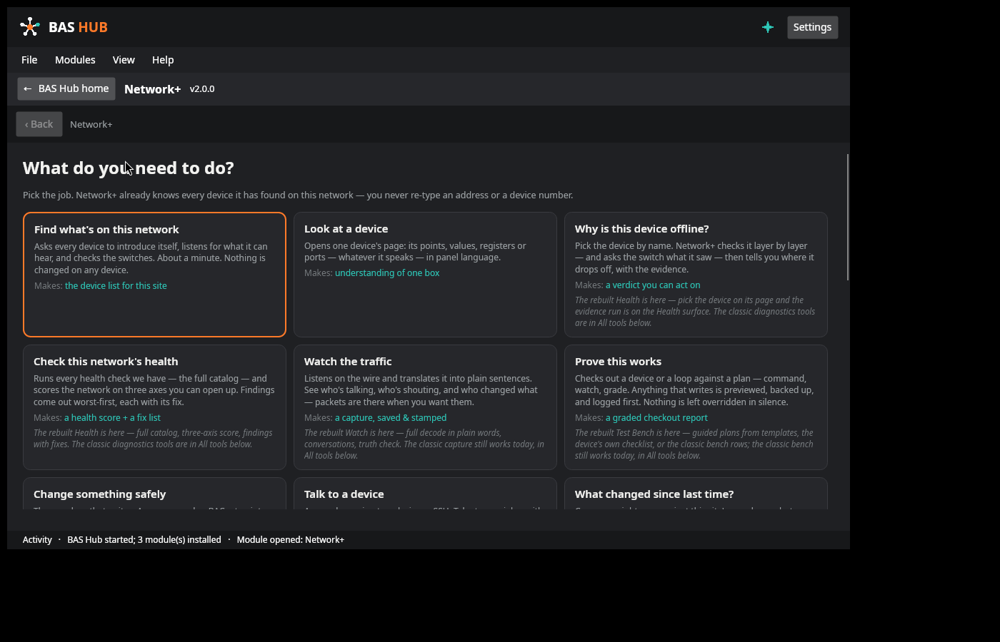

- **Find.** Ask the network who's out there. BACnet/IP discovery, Modbus, and OPC UA devices all land in the one shared inventory — you never re-type an address or a device number anywhere else in the app.
- **The device page is the spine.** One page per device: its state, how it was found, its health axes, and every job for that device — points and values, schedules, trend history, its traffic, the console, its baseline. Protocols are capabilities of the device, never separate rooms to visit.

  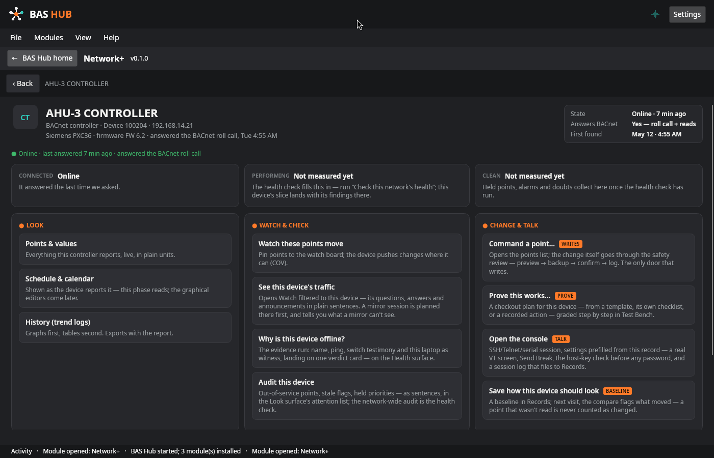

- **Watch.** Packet capture that reads back in **plain sentences** — who asked, who answered, what changed — with conversations, filter presets written in BAS terms, and a Capture Truth Check computed from the capture file's own counters, so you know what the capture can and cannot prove. Captures open and save as standard pcap/pcapng.
- **Health.** A 40-check diagnostics catalog run over your device records, your laptop's own readings, and a capture if you give it one. The score comes in three axes — Connected, Performing, Clean — and **always** arrives with the findings that moved it. An axis with no evidence says *Not measured* instead of guessing. "Why is this device offline?" runs a layer-by-layer evidence gather and lands on a verdict card you can act on. Runs compare before/after, and the report job files straight to a site.

  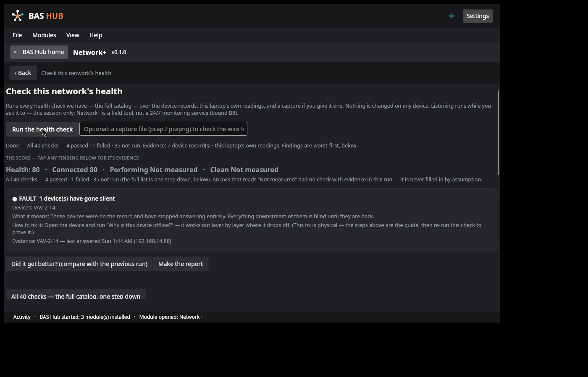

- **Test Bench — the only door that writes.** Browsing surfaces never write, anywhere in Network+. Changes live here, as plans: from bounded templates, the device's own checklist, classic bench rows, or a recorded action. Every plan is **previewed from real reads first**; the current values are backed up before anything is written — and if a backup read fails, the run blocks and nothing is written at all. One confirm, a graded run, verify by read-back, and a rollback that puts the old values back through the same engine. Modbus writes live here and nowhere else, with the device's own read-back as the receipt. A built-in Lab — a simulated peer with fault injection — lets you practise a plan against a device that misbehaves *before* a site visit depends on it.

  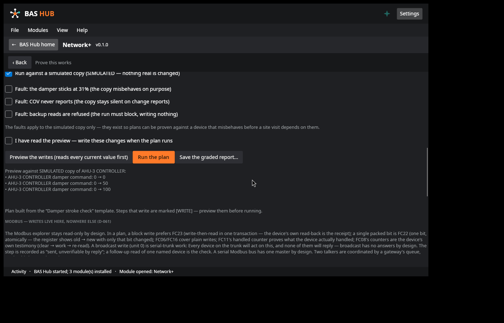

- **Console.** A real VT terminal — full-screen menus, colour, alternate screen — for SSH, Telnet, and serial sessions, prefilled from the device record with every default named. SSH host keys are judged **before** any password is sent; passwords live in session memory only and are never stored. Send Break works where the wire supports it and is refused in plain words where it doesn't. Session logs file to a site.
- **Records.** "What changed since last time?" — revisit diffs in plain words, device baselines with per-fact drift (a point that wasn't read is never counted as changed), and hashed exports that re-verify every file and name each one verified, changed, missing, or unlisted.

<strong>Network+ in full — workspace by workspace</strong>

**Find**
- Discovery across BACnet/IP (its own BACnet stack, including BBMD foreign-device registration for reaching across subnets), Modbus, and OPC UA, plus a LAN census of what is answering on the wire.
- Everything found lands in the shared Inventory Core as a DeviceRecord. Identity merges on BACnet instance + network first, then MAC, then IP — so re-finding a device updates its record instead of duplicating it.
- Field changes are logged against the record; snapshots diff as ADDED / REMOVED / CHANGED.

**Look (the device page)**
- Points & values in panel language with engineering units; schedules and calendars as the device reports them; trend history (graphs first, tables second, exportable with the report).
- Per-device audit: out-of-service points, stale flags, held priorities — as sentences, in an attention list.
- The laptop is a witness, not just a tool: Network+ keeps a record of this machine's own adapters and readings, so "the device dropped" can be told apart from "my laptop dropped".

**Watch**
- Full BACnet decode under the plain-sentence layer — nothing is hidden, it's layered: sentence first, decode one step down, raw frame at the bottom.
- Conversations view, filter presets, and a filter builder written in BAS terms instead of capture-filter syntax.
- Capture Truth Check: the capture's own counters state what fraction of the wire it actually saw — the badge travels with the capture.
- Capture Compare between two captures; captures recorded on another BAS Hub import with their provenance noted; export as classic pcap.
- BACnet/SC is reported honestly: Watch does not pretend to decrypt what it cannot.

**Health**
- The full catalog: 40 checks in layers — this laptop, the network, the devices — including switch-port testimony and a Wi-Fi section whose bounds are printed on its face; MS/TP bus checks that say plainly when a run holds no trunk evidence to judge.
- Three-axis scoring (Connected / Performing / Clean) with a hard evidence rule: a check with no evidence reports **Not run** — "a pass would be a guess" — never a silent pass. The headline score exists only as the sum of its findings; tap any finding for its evidence.
- "Why is this device offline?" — the evidence run: name, ping, switch testimony, and this laptop as witness, gathered in the open, landing on one verdict card.
- Before/after compare against the previous run, and a report (Markdown) filed to a site with the run's evidence attached.

**Test Bench (Prove / Change / Practise)**
- Plan sources: bounded templates in BAS words, classic rows, the device's own checklist, or record-a-real-action into a plan.
- Every writing step is marked **[WRITE]** in the plan. Preview reads every current value first; the backup is a persisted file before the first write goes out; execution is sequential with a per-entry log; read-back verify where the plan asks for it; the receipt is the run's graded report.
- Rollback writes the prior values back through the same engine and the same confirm discipline.
- The full Modbus write set lives here only (D-061 discipline: the Modbus explorer elsewhere is read-only by design), preferring write-then-read in one transaction so the device's own read-back is the receipt.
- A gateway card for Modbus gateway work, an offline frame parser for checking frames without a wire, and the Lab: a simulated peer, clearly badged SIMULATED, with fault injection (a damper that sticks, a device that never reports COV, backup reads refused) so plans can be proven against a device that misbehaves.

**Console (Talk)**
- A real VT terminal emulator: full-screen menus, colour, alternate screen, DEC line-drawing characters.
- SSH, Telnet, and serial sessions prefilled from the device record, every default named on the surface. Host keys are judged before a password is ever sent; the profile type provably has no password field — passwords exist in session memory only.
- Canned commands (the switch dialect most BAS gear speaks) plus your own, saved on this machine and offered on every session; an expert drawer for exact bytes and pacing.
- Send Break, honestly per wire: a real 250 ms pulse on serial, the IAC BRK byte sequence on Telnet, and a plain-word refusal on SSH — the shipped SSH library has no break request, and the surface says so instead of faking it.
- Session logs in the PuTTY style, filed to a site.

**Records**
- Revisit diffs in BAS words with identity-fallback matching, so a device whose address changed is still recognised as itself.
- Baselines: save how a device should look; on the next visit, drift is reported per fact — and an unread point is never counted as changed.
- A filed-records browser unifying captures, reports, checkout reports, and console logs, each with its SHA-256 fingerprint; hashed exports re-verify every file and name each VERIFIED / CHANGED / MISSING / unlisted.

## BAS Copilot — help that stays on the machine

BAS Copilot is an **optional** module, chosen at install. It runs entirely on your computer: the panel says so on its face, and it's built so there's nothing to switch off — no account, no sign-in, no cloud, nothing typed into it leaves the machine. It can explain and draft — a capture in plain words, an error translated, notes and reports drafted, questions answered about your records. It **never acts**: no device writes, no sends, no file changes come from the assistant. Skip it, and BAS Hub has no chat surface anywhere — the icon simply isn't there.

At install, Setup checks your computer and offers only the model sizes it can run well. Locked tiers say why, in plain language.

| Tier | Needs | Download | What it's for |
| --- | --- | --- | --- |
| **Field Helper** | 4 GB RAM | ≈ 1.1 GB | Quick answers, plain-English explanations, and short summaries. Best for older laptops. Weaker at long or complicated material. |
| **Standard** | 8 GB RAM | ≈ 2.1 GB | A solid all-rounder: explains captures and errors, drafts notes and reports, answers questions about your records. The right pick for most machines. |
| **Solid** | 16 GB RAM | ≈ 4.7 GB | Noticeably sharper reasoning. Handles long captures and multi-step problems, drafts the most polished text. Needs a modern laptop. |
| **Workshop** | 32 GB RAM | ≈ 9.0 GB | The strongest tier. For high-spec machines only. |

  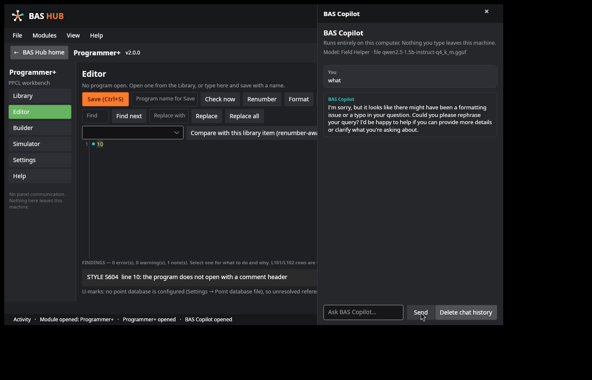

<strong>Copilot details — tiers, swapping, and its privacy posture</strong>

- **How it runs:** a local inference engine process started per conversation turn and stopped when the turn ends — no background service, nothing resident between questions. Chat history persists locally, on your machine, and the panel offers a one-tap delete.
- **Choosing and changing tiers:** picked at install from the sizes your hardware supports (RAM is the gate; the reasons are shown, not hidden). You can change tier later in Settings → Modules; the new model downloads verified against its checksum, and a failed download changes nothing — the existing model stays byte-identical.
- **The download is the only network moment:** the model file at install (or at a tier swap you start), verified against a published SHA-256 before it is used. Pre-staged model files placed beside the installer are picked up and hash-verified instead — the offline route for sites with no internet.
- **Zero-egress by construction:** the module ships with no networking code of its own. What you type is processed on this computer and stays on this computer.
- **Honest limits:** answer quality scales with tier — the smallest model is a helper, not an authority. Check its work the way you'd check a junior tech's.

## Screenshots

Real captures of the shipping build and its final test rigs — no mockups, no staged data presented as a real site.

|  |  |
| --- | --- |
|  **Home** — modules as tiles with earned ready states; your categories and shortcuts below. |  **Network+** — pick the job, not the protocol. |
|  **Programmer+ editor** — checks run as you type; every finding says what to do and why. |  **Programmer+ simulator** — a sample program running against a plant, the trend as evidence. |
|  **The device page** — one device, one page; every job for it starts from the same record. |  **Health** — the score always arrives with its findings; an axis with no evidence says *Not measured*. |
| 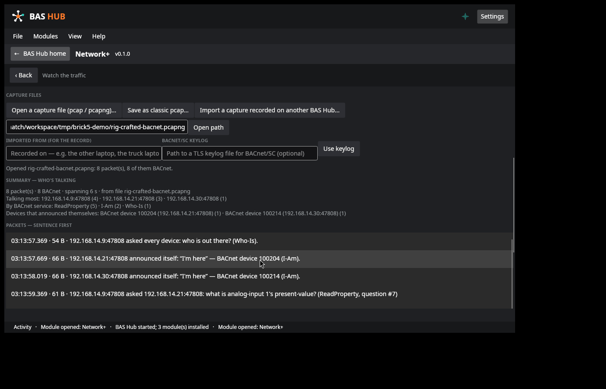 **Watch** — a capture read back in plain sentences. *(Demonstration capture file; live capture uses the optional Npcap step at install.)* |  **Test Bench** — a plan previewed against a simulated copy before it ever runs against a real device. |
| 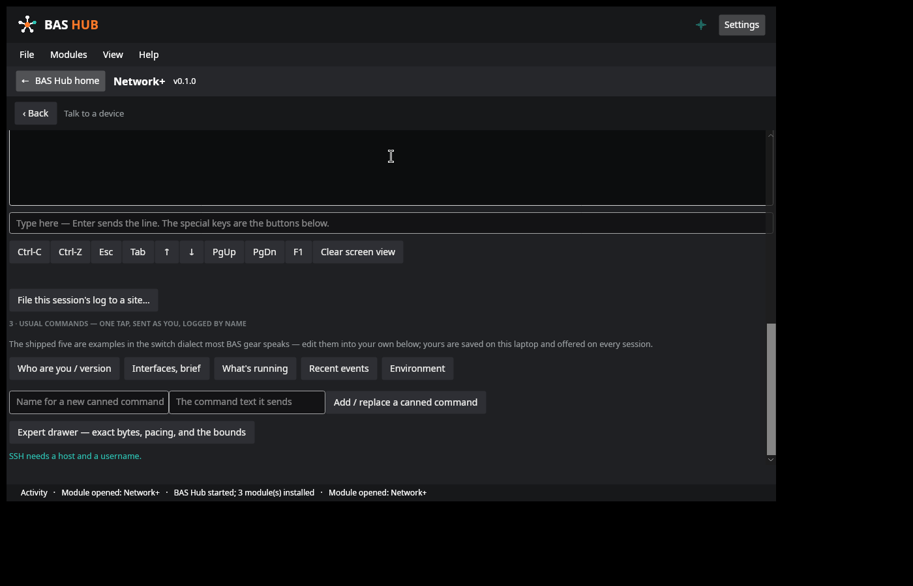 **Console** — a real VT terminal, your usual commands one tap away, session logs filed to Records. |  **BAS Copilot** — states its terms on its face: everything runs on this computer. |
| 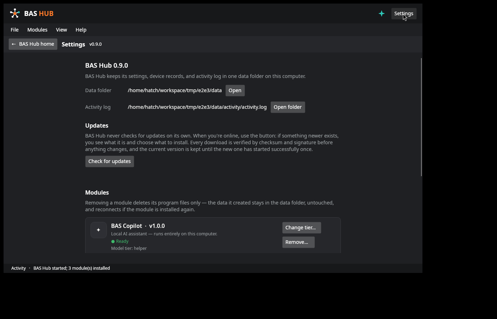 **Settings** — the update check is a button you press; downloads verify before anything changes. |  **In motion** — home → Network+ → Health → Programmer+, live on the test rig. |

## Download & install

1. Open the [**latest release**](https://github.com/JacobHamrac/bas-hub-releases/releases) and download all three files: **`BAS Hub Setup.exe`**, **`payload.zip`**, and **`payload.sha256`**. Keep them together in one folder — the installer needs all three. (Verify `payload.zip` against `payload.sha256` if your process asks for it; Setup checks it again itself before installing anything.)
2. Double-click **`BAS Hub Setup.exe`**. BAS Hub needs **no administrator rights** and installs for your user account only, in a location you choose.
3. Pick the **complete package**, or just the modules you want. Two optional extras:
   - **BAS Copilot** — Setup checks this computer and offers the model sizes it can run well, then downloads the one you choose, verified against a published checksum.
   - **Npcap** (packet-capture driver, offered inside the Network+ choice — Watch needs it for live capture) — if you pick it, Setup downloads it from npcap.com and runs its own signed installer; that step — the only one — asks for administrator approval. Everything else works without it.
4. Launch **BAS Hub** from the Start menu or your desktop. Your data lives in `%LOCALAPPDATA%\BAS Hub\data` and is never removed by updates or by uninstalling.

Installs are staged and committed as one move: a failed or cancelled install leaves the previous state untouched — never a half-installed app. The download also includes **`README-FIRST.txt`** (the full install reference) and **`SBOM.json`** (the software bill of materials for this release). A Linux build ships in the download's `linux` folder and installs the same way.

<strong>Install variants — silent deployment, module selection, exit codes (for IT)</strong>

`BAS Hub Setup.exe` is scriptable end to end. Every switch is optional; an interactive install and a silent one produce the same receipt.

| Switch | Meaning |
| --- | --- |
| `/silent` | Install the complete package per-user, no UI |
| `/modules=programmer-plus,network-plus,bas-copilot` | Install only the listed modules |
| `/ai=auto` or `/ai=<tier>` | Copilot model handling: `auto` picks the best tier this machine runs well; a tier name (`helper`, `standard`, `solid`, `workshop`) picks that tier; leaving Copilot out of `/modules=` skips AI entirely |
| `/npcap` | Include the Npcap driver step (its own signed installer; will prompt for elevation) |
| `/target=<path>` | Override the install location |
| `/update-check` | Report whether an update is available; exit code 8 means yes |
| `/verify` | Verify an existing install against its receipt |
| `/uninstall` | Remove the install (program files only; data kept). Add `/purge` to also remove user data |

**Exit codes:** 0 ok · 1 error · 2 not installed · 3 bad arguments · 4 payload checksum mismatch · 5 downgrade refused · 6 cancelled · 7 verification failed · 8 update available (with `/update-check`).

Every install writes a receipt (`install.json`, inside the install folder) listing every file with its SHA-256, the modules chosen, and the Copilot tier — `/verify` re-checks a machine against it byte for byte.

## System requirements

| | |
| --- | --- |
| **Operating system** | Windows, 64-bit *(a Linux build is included in the download)* |
| **Runtime prerequisites** | None — BAS Hub is self-contained; there is no framework or runtime to install first |
| **Disk** | About 200 MB for the app itself; BAS Copilot adds ≈ 1.1–9.0 GB depending on the tier you choose |
| **Memory** | No special requirement for the Hub, Programmer+, or Network+; BAS Copilot tiers need 4–32 GB by tier (see the table above) — Setup only offers tiers your machine can run well |
| **Admin rights** | Not required. The single exception is the optional Npcap driver step, which uses Npcap's own signed installer |
| **Internet** | Not required to run. Only the actions you start use it: checking for updates, downloading a Copilot model |

## Updates

BAS Hub **never checks for updates on its own**. *Settings → Check for updates* is the only update path, and it's a button you press when you're online. If something newer exists, you see what it is and choose what to install — Copilot items are listed separately and start unpicked, so a model never changes unless you choose it. Every download is verified by **checksum and signature** before anything is applied, and the previous version is kept until the new one has launched successfully once. Each release here carries its full notes on its release page.

  

<strong>Update mechanics — how a release travels, step by step</strong>

1. **Check (only when you ask).** The checker fetches the release manifest from this repository's latest release. Nothing is fetched in the background, ever; there is no schedule and no polling.
2. **Verify the manifest.** The manifest is digitally signed (RSA) with the BAS Hub release key, whose public half is embedded in the app. A manifest that doesn't verify is refused outright.
3. **Plan.** You see the new version, its notes, and exactly which modules would change, with sizes. Copilot items are separate and start unpicked.
4. **Download & verify again.** Each file is checked against its SHA-256 from the signed manifest before anything is applied. A mismatch refuses the update.
5. **Apply, keeping the way back.** The current version is set aside, not deleted. The new version must launch successfully once before the old one is let go; an update that fails to launch is reverted.
6. **IT control.** An IT-policy switch can disable update checking entirely on managed machines — the Settings surface then says so, in words, instead of failing mysteriously.

## Your data, maintenance, and uninstalling

**One data folder.** Settings, device records, snapshots and write-safety backups, Sites and everything filed to them, captures and reports, crash reports, the activity log, and Copilot's chat history all live under `%LOCALAPPDATA%\BAS Hub\data` — wherever you chose to install the program. Updates never touch it. Automatic write-safety backups persist against the device record by default; filing them under a site is your choice, never a required step. Exports never contain credentials.

**Maintenance.** Run Setup again on a machine that already has BAS Hub and it opens as a **maintenance screen** instead: **Update** (the same checked, verified path as Settings), **Change modules** (add or remove modules and Copilot tiers — removing a module deletes its program files only; the data it made stays and reconnects if you reinstall it), **Verify** (re-check the install against its receipt), and **Uninstall**.

**Uninstalling.** Uninstall removes exactly what the install receipt lists — the program, nothing else. Your data folder is kept by default; removing it too is an explicit choice (a checkbox in the maintenance screen, `/purge` in silent mode), never the default.

## Trust, by design

- **No telemetry. No phone-home.** Nothing is sent anywhere automatically — including crash reports. If BAS Hub ever crashes, it saves a structured report on *your* computer (the last 10 are kept, secrets kept out), and the next launch tells you in plain language that one was saved and offers to open the folder. Sending it anywhere is your act, never the app's.
- **Local-first data.** One standard per-user folder; it survives updates and uninstalls; exports never contain credentials.
- **Secrets stay in the vault.** Credentials are kept in Windows Credential Manager / DPAPI — never in plain-text files. Console passwords are held in session memory only and are never stored at all; console profiles by design have no password field.
- **Write safety on live controllers.** The Test Bench is the only door that writes. Preview from real reads → backup persisted first → your confirm → graded writes with read-back verify → a receipt, and rollback through the same path. A failed backup read stops the run cold: nothing is written. Browsing surfaces hold no write code path at all.
- **Verified downloads.** Release manifests are digitally signed and payloads are checksummed; a download that doesn't verify is refused, not installed. The installer itself verifies the payload hash before it stages a single file.
- **Least privilege, nothing lurking.** Per-user install, no administrator rights for the app, no background services installed, no listening sockets opened by default. Anything that listens runs only while you run it, shows its state, and stops when you stop it.
- **Honest surfaces.** Where the app can't do something — a capture that proves less than it seems, a health axis with no evidence, a break a wire doesn't support — the surface says so, in words, on its face. That posture is a feature, and it is tested like one.

## FAQ

**Is BAS Hub open source?**
No. BAS Hub is proprietary software, distributed as binaries. This repository is the download and information point; it does not and will not contain source code.

**Does it work on a site with no internet?**
Yes — it was designed for exactly that. Field networks are often offline, so everything works locally; the only features that want a connection are the ones you start yourself (an update check, a Copilot model download — which can also be pre-staged beside the installer and hash-verified offline).

**Do I need administrator rights to install or run it?**
No. The one exception is the optional Npcap packet-capture driver, which installs through its own signed installer and asks for approval then. Everything else in BAS Hub works without it — and without admin rights at all.

**Is Copilot a cloud AI? Does it send my data anywhere?**
No, and no. Copilot is an optional module that runs a model entirely on your computer; it ships with no networking code. If you don't install it, BAS Hub has no chat or AI surface anywhere.

**Can Copilot change anything on a device?**
No. Copilot explains and drafts — it never acts. It has no path to device writes, sends, or file changes. Every write in BAS Hub goes through the Test Bench's confirm path, by a person.

**How good are Copilot's answers?**
It depends on the tier — bigger models reason better, and Setup only offers tiers your machine can run well. Treat it as a capable assistant, not an authority: check its work the way you'd check a junior tech's.

**Where does my data live? What happens when I uninstall?**
Everything lives in `%LOCALAPPDATA%\BAS Hub\data`. Uninstalling removes the program and leaves your records in place; they reconnect if you reinstall. Deleting the data too is an explicit opt-in, never the default.

**Can IT deploy it silently?**
Yes. Silent per-user deployment with module and Copilot selection, verification and uninstall verbs, and documented exit codes (full table above and in `README-FIRST.txt` inside the download). An SBOM ships with every release, and an IT-policy switch can disable update checking on managed machines.

**Does Programmer+ download programs to panels?**
No. Programmer+ is an authoring workbench — it works on program files (editing, checking, simulation, imports). It never communicates with a panel.

**What does "0.9.0" mean — is this finished software?**
The version number means what it says. 0.9.x is the pre-1.0 line: 0.9.0 is the complete first release of the suite, and **1.0.0 is reserved for the first release proven end-to-end in the field**. Every version ships with its own release notes, and this page is updated with every release — a page that no longer matches the shipped build is treated as a defect, same as stale help.

## License

BAS Hub is **proprietary software**. © 2026. All rights reserved.

This repository contains release downloads and product information only. No source code is published here. Your use of the software is governed by the proprietary terms stated in the download.

BAS Hub is proprietary software · © 2026

