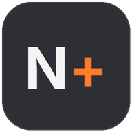

  <picture>
    <source media="(prefers-color-scheme: dark)" srcset="assets/hero-dark.png">
    <source media="(prefers-color-scheme: light)" srcset="assets/hero-light.png">
    
  </picture>

  
  
  
  
  

---

## The full product site lives at **[bas-hub-app.github.io](https://bas-hub-app.github.io/)**

Screenshots, the demo, module tours, install reference, FAQ, and every release's notes, the complete BAS Hub site:

  <a href="https://bas-hub-app.github.io/"><strong>→ bas-hub-app.github.io</strong></a>

This repository is the download shelf: it carries the release downloads (the current release is 0.9.9, iteration 8) and this gateway page. It contains no source code, and it never will: BAS Hub is proprietary software.

---

**BAS Hub** is a desktop suite for building-automation controls work. Instead of separate tools (one for programming, one for discovery, one for captures, one for the terminal, a spreadsheet for the records), BAS Hub is one app whose modules are separate tools under one roof: each module carries its own discovery, its own settings and its own help, and a write to a live controller goes through the same safety path every time. Everything the modules save lives in one file system on your laptop, organised by site — open a site and everything for that site is together, whichever module made it — and nothing leaves it unless you send it.

## The modules

<table>
  <tr>
    <td width="16%" align="center">
       
      <strong>The Hub</strong> 
      The Launch Pad: the home screen and launcher. Your modules as tiles, your own categories of shortcuts to the tools you already use, and the Module Manager.
    </td>
    <td width="16%" align="center">
       
      <strong>Programmer+</strong> 
      The PPCL workbench: editor, block builder, simulator and debugger, point database, and code library.
    </td>
    <td width="16%" align="center">
       
      <strong>Network+</strong> 
      The network workbench: scan a network into a temporary network, open any device on its own page, snapshot and back up, and run batch work across devices.
    </td>
    <td width="16%" align="center">
      R+ 
      <strong>Reports+</strong> 
      The reporting studio: 60 report subjects, fed by vendor files and by the shared file system's saved networks; built, previewed, edited, and exported in one place. PDF, XLSX, CSV, TXT out.
    </td>
    <td width="16%" align="center">
      ✓ 
      <strong>TBC+</strong> 
      Automated preventive-maintenance testing: planned, gated PM visits across many devices, with as-found and as-left reporting.
    </td>
    <td width="16%" align="center">
       
      <strong>BAS Copilot</strong> <em>(optional)</em> 
      An assistant that runs entirely on your computer. If you don't install it, there is no chat surface anywhere in BAS Hub.
    </td>
  </tr>
</table>

## Current release: 0.9.9 — iteration 8

> **BAS Hub 0.9.9, iteration 8 (build iter8, 2026-11-20), is the current build of the current release.** Separate per-OS packages: download the installer for your OS from the [**0.9.9 iteration 8 release**](https://github.com/JacobHamrac/bas-hub-releases/releases/tag/v0.9.9-iter8). Iteration 8 is the verbatim conformance build: a conformance census had found 156 unauthorized divergences between the built surfaces and their designs of record, and this build closes every lane-fixable one — a full re-audit over fresh captures at both window sizes finds 31 of 35 surfaces verbatim, with the remainder waiting on the owner's own rulings, named below and in the release notes. The Connection Wizard is retired: connecting happens at the designed connect doors, with the BACnet/IP tally strip, and the scan opens on its designed scope page. TBC+ now ships obfuscated like the other modules — a pre-existing defect this build found and fixed — and its saved-state contracts are probe-proven on the shipped build itself. Console session logs live in memory only; saving one is the user's explicit act. The alarms face is recomposed to its design as rendered. **Stated plainly: this build has not been installed or driven on the owner's Windows laptop.** Its full gate battery passed clean over the shipped payload (security teardown and destruction 61 of 61, tamper refused, every compiler warning accounted), and the shipped Linux build installs silently and verifies file-for-file. Still open, named in the release notes: the Launch Pad menu strip and drawer (owner decision pending), the unreachable Trends Customize face (door ruling pending), the shell-menus design against the owner's isolation rulings (owner decision), the BINDING-PENDING palette and type list BP-1 to BP-6 with the alarms tint and type deltas (ruling pending), four verbatim-against-no-gloss collisions the designs themselves mandate, the P1 Ready face and live-capture legs this build environment cannot stage, and the help corpus's missing command and what-can-go-wrong topics. A Windows ARM64 package rides in the same release as a candidate build; it has not been verified on ARM64 hardware. The in-app update check reads the latest stable release, so earlier installed builds are offered this one by the app itself. Full notes for every build are on the [website's versions page](https://bas-hub-app.github.io/releases.html).

| File | Size (bytes) | SHA-256 |
| --- | ---: | --- |
| BAS-Hub-Setup-Windows-x64.exe | 175,388,595 | `723b4f382910f9855281c6852b1e0f329590e921a8c9479ba12a08e12fa661a3` |
| BAS-Hub-Setup-Linux-x64 | 176,215,608 | `cdf09136ac1509abf01f7e651556f9454e1d92a591a4d1725af3c27066a15bfd` |
| BAS-Hub-Setup-Windows-ARM64.exe (candidate) | 172,701,637 | `9ad098f20a0c39399f1d7c49e67a0b4891418ffc9b5d354cd8b5d06712fa5e08` |
| BAS-Hub-User-Guide-0.9.9.pdf | 2,803,681 | `3bc588b64690051750891ffc6b5d77ab0fd0b1754f0bb2aa5c2bd054045120fd` |
| SBOM.json | 17,287 | `93a8cdd66231060daad05425bde64ab71d87293d6fdbd5e4816ca82b8b58531f` |

**Download & install**

1. Open the [**0.9.9 iteration 8 release**](https://github.com/JacobHamrac/bas-hub-releases/releases/tag/v0.9.9-iter8) and download the installer for your OS: **`BAS-Hub-Setup-Windows-x64.exe`** (Windows) or **`BAS-Hub-Setup-Linux-x64`** (Linux): each is one self-contained file, with `SBOM.json` and the User Guide (PDF) beside it in the download set.
2. Run the installer. BAS Hub needs **no administrator rights** and installs for your user account only, in a location you choose.
3. Pick the **complete package**, or just the modules you want. Optional extras: **BAS Copilot** (Setup offers the model sizes this computer can run well) and **Npcap** (the packet-capture driver for Network+ live capture, its own signed installer, the one step that asks for administrator approval).
4. Launch **BAS Hub** from the Start menu or your desktop. Your data lives in `%LOCALAPPDATA%\BAS Hub\data` and is never removed by updates or by uninstalling.

The full install reference (requirements, silent-deployment switches, and exit codes) is on the [website](https://bas-hub-app.github.io/#download).

## License

BAS Hub is **proprietary software**. © 2026. All rights reserved.

This repository contains release downloads and product information only. No source code is published here. Your use of the software is governed by the proprietary terms stated with each release.

BAS Hub is proprietary software · © 2026

